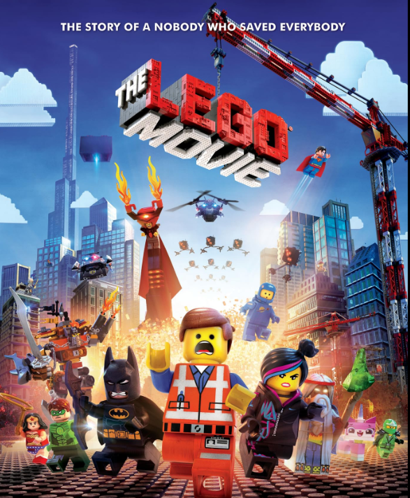

# Movie Magic

In 2014 the Lego movie was released. Demand for Lego surged, creating a buyer's market. The movie was released at an opportune time. In 2015 the oil market crashed forcing up the prices of imported goods in NZ. At the same time the NZ dairy market crashed by approximately 50%. Leading to a 20% crash in the NZ dollar. The cost of everything in NZ went up for the average consumer, but not Lego. A surge in demand caused by the movie made Lego cheaper compared to other goods. 


{width=80%, fig-align="center"}
  
(IMDB, 2014)

```{r load data}
#| message: false
#| echo: false
#| warning: false

library(tidyverse)
library(ggdist)

# load in lego from a previous portfolio

lego_sets <- read_csv("https://www.massey.ac.nz/~jcmarsha/data/lego/lego_sets.csv")
lego_parts <- read_csv("https://www.massey.ac.nz/~jcmarsha/data/lego/lego_parts.csv.gz")

#===== embedding the CPI data =====#
# CPI <- read_csv("Computer_science/161_307_reproducible_visualisation_for_Statistics/Portfolio/CPI.csv") %>%
#   mutate(Date = as.Date(Date, format = "%d-%m-%Y"),
#          year = as.numeric(format(Date, "%Y"))) %>%
#   group_by(year) %>%
#   summarise(mean_cpi = mean(`CPI (Annual % change)`)) #annual average CPI

# saveRDS(CPI, "CPI.rds")

#===== read from embdded data =====#

#===== initial wrangling =====#
set_weights <- lego_parts |>
  group_by(set) |>
  summarise(weight = sum(weight*quantity, na.rm=TRUE))

```


## The Lego Market Under Threat

The below chart shows how the inflation indexed prices of Lego sets increased for all themes, above the market price. Meaning that Lego sets became cheaper relative to other goods the customer may buy. This demand peaked in 2015 and returned to normal in mid 2016. During this time sellers in NZ were offering discounted Lego sets in order to move stock, sacrificing short term profits for long term ones. Without "The Lego Movie" this demand would not have been, and the Lego market would likely have followed other non-essential items into a period of reduced sales.  


```{r figure one}
#| fig-align: center
#| fig-width: 10
#| fig-height: 8
# make an appropriate figure
#I am assuming you want to see the code. 
CPI <- readRDS("C:/Users/johnl/Documents/Computer_science/161_307_reproducible_visualisation_for_Statistics/Portfolio/CPI.rds")

#===== indexing the price to inflation =====#
#use 2012 as base year for inflation index
#indexed_price = nominal_price × (CPI_target_year / CPI_original_year)
#I won't use 'real price' in this as it is jargon for the deflated price. 

base_year = min(lego_sets$year)
base_CPI <- CPI$mean_cpi[CPI$year == 2012]

sets_with_weight <- lego_sets |>
  left_join(set_weights, by=join_by(set)) |>
  left_join(CPI, by = "year") |>
  mutate(indexed_price = price * (base_CPI / mean_cpi))

prices <- sets_with_weight %>% 
  filter(!is.na(indexed_price) | !is.na(price)) %>%
  group_by(year, theme) %>%
  summarise(indexed_price = mean(indexed_price), 
            price = mean(price), 
            .groups = 'drop')

#===== create graph one =====#
prices %>%
  ggplot(aes(x = year)) +
    annotate("rect", xmin = 2014, xmax = 2016.5, ymin = -Inf, ymax = Inf,
           fill = "grey44", alpha = 0.2) +
    geom_line(aes(y = price, col = "Market price"), linewidth = 0.8) +
    geom_line(aes(y = indexed_price, col = "Inflation indexed price")) +
    geom_vline(aes(xintercept = 2014, col = "Lego Movie released"), linetype = "dashed") +
    facet_wrap(~ theme) +
    #scale arguments
    scale_color_manual(
      values = c(
        "Market price" = "#18246e",
        "Inflation indexed price" = "#aa2323",
        "Lego Movie released" = "black"
      ),
      name = ""
    ) +
    #labels
    labs(title = "'The Lego Movie' effect",
       subtitle = "In 2014 'The Lego Movie' hit cinemas, creating a demand surge for lego,\ndriving the inflation indexed price up while the market price remained low until mid 2016",
       y = "Price (NZD)",
       x = "Year") +
    #theme
    theme_minimal() +
    theme(
      legend.position = 'top',
      plot.title = element_text(size = 20, face = "bold"),
      plot.subtitle = element_text(size = 15),
      strip.text = element_text(face = 'bold'))


```

## A rise and return to normal

After the economic conditions stabilised a price correction took place. Year on year price changes for both market price and inflation indexed prices are expected to be in lock step. During the period 2016 to 2018, the market price rose over the inflation indexed price, peaking in 2017, before converging with the inflation indexed price by 2018. This is particularly evident within the 'Creator', 'Ideas' and 'Modular Buildings' themes. 
During this time Lego sets were earning sellers more than usual profits. A sequel to "The Lego Movie's" initial increase to demand, and perhaps a welcome reprieve from the skinny margins of 2014-2016.   

```{r figure 2}
#| fig-align: center
#| fig-width: 10
#| fig-height: 8

prices %>%
  arrange(year) %>%
  group_by(theme) %>%
  mutate(price_change = (price - lag(price))/ lag(price),
         idx_price_change = (indexed_price - lag(indexed_price))/lag(indexed_price)) %>%
  filter(!is.na(price_change)| !is.na(idx_price_change)) %>%
  #plot
  ggplot(aes(x = year)) +
    annotate("rect", xmin = 2016, xmax = 2018, ymin = -Inf, ymax = Inf,
           fill = "grey44", alpha = 0.2) +
    geom_line(aes(y = price_change, col = "Market price"), linewidth = 0.8) +
    geom_line(aes(y = idx_price_change, col = "Inflation indexed price"), linewidth = 0.5) +
    geom_vline(aes(xintercept = 2014, col = "Lego Movie released"), linetype = "dashed") +
    facet_wrap(~ theme) +
  #scale argument
    scale_color_manual(
      values = c(
        "Market price" = "#18246e",
        "Inflation indexed price" = "#aa2323",
        "Lego Movie released" = "black"
      ),
      name = ""
    ) +
    scale_x_continuous(breaks = seq(2013, 2021, by = 2)) +
    #labels
    labs(title = "'The Lego Movie' effect sequel",
       subtitle = "After the market correction, year on year indexed price change % dipped below market price\nfrom 2016 to 2018 before converging with the market price once more.",
       y = "Price change (%)",
       x = "Year") +
    #theme
    theme_minimal() +
    theme(
      legend.position = 'top',
      plot.title = element_text(size = 20, face = "bold"),
      plot.subtitle = element_text(size = 15),
      strip.text = element_text(face = 'bold'))

```


# References:

IMDB (2014), **The Lego Movie**, https://www.imdb.com/title/tt1490017/mediaviewer/rm1316605952/